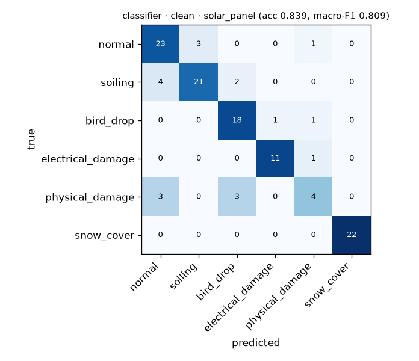
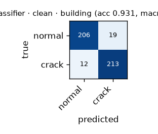
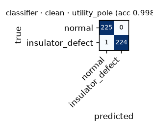
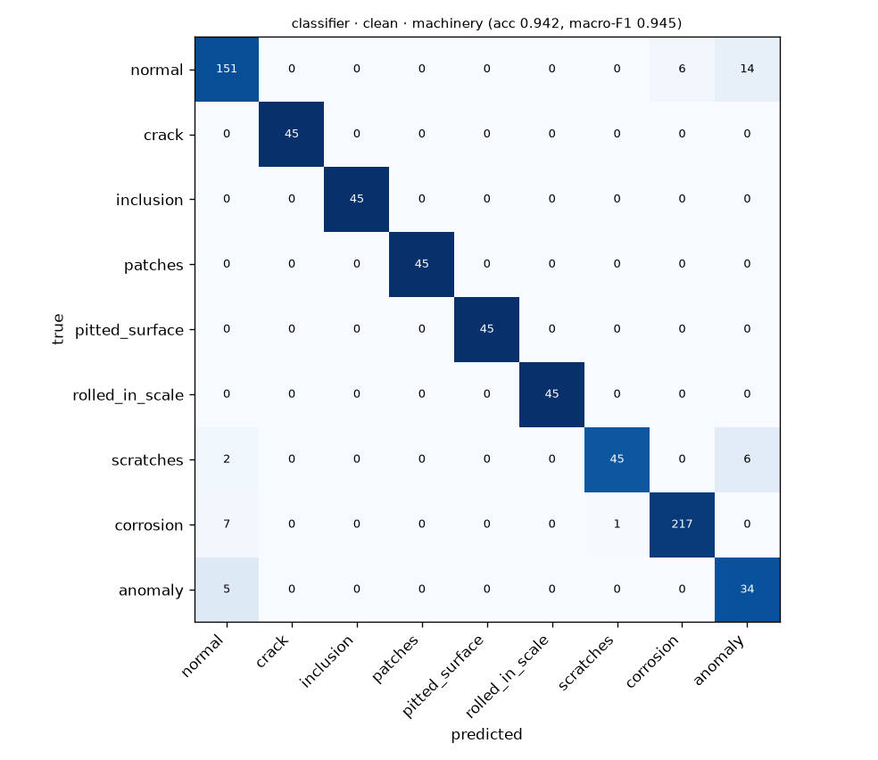

# Condition classification — evaluation

Split: **test** of `dataset/processed/manifest.csv` · backbone `dinov2_vits14` · classifier trained 2026-10-08T20:56:12.150023+00:00 (manifest d0df8375bfb5).

Baseline = nearest-neighbour label copy over clean training embeddings (previous approach).
Webcam = each test image degraded once by `ml/augment.py` (blur, JPEG, colour cast, perspective, crop).

## Overall

| model | images | accuracy (clean) | mean macro-F1 (clean) | accuracy (webcam) | mean macro-F1 (webcam) |
|---|---|---|---|---|---|
| baseline | 1731 | 0.929 | 0.873 | 0.908 | 0.857 |
| classifier | 1731 | 0.947 | 0.921 | 0.945 | 0.933 |

## Per asset type

| asset type | model | n | acc clean | macro-F1 clean | acc webcam | macro-F1 webcam | defect recall | false-alarm rate |
|---|---|---|---|---|---|---|---|---|
| solar_panel | baseline | 118 | 0.695 | 0.666 | 0.703 | 0.684 | 0.857 | 0.259 |
| solar_panel | classifier | 118 | 0.839 | 0.809 | 0.881 | 0.868 | 0.923 | 0.148 |
| building | baseline | 450 | 0.898 | 0.898 | 0.856 | 0.855 | 0.907 | 0.111 |
| building | classifier | 450 | 0.931 | 0.931 | 0.916 | 0.916 | 0.947 | 0.084 |
| utility_pole | baseline | 450 | 0.996 | 0.996 | 0.984 | 0.984 | 0.996 | 0.004 |
| utility_pole | classifier | 450 | 0.998 | 0.998 | 0.993 | 0.993 | 0.996 | 0.000 |
| machinery | baseline | 713 | 0.945 | 0.933 | 0.927 | 0.904 | 0.952 | 0.058 |
| machinery | classifier | 713 | 0.942 | 0.945 | 0.944 | 0.954 | 0.974 | 0.117 |

## Per class (classifier, clean)

### solar_panel

| class | precision | recall | F1 | support |
|---|---|---|---|---|
| normal | 0.767 | 0.852 | 0.807 | 27 |
| soiling | 0.875 | 0.778 | 0.824 | 27 |
| bird_drop | 0.783 | 0.900 | 0.837 | 20 |
| electrical_damage | 0.917 | 0.917 | 0.917 | 12 |
| physical_damage | 0.571 | 0.400 | 0.471 | 10 |
| snow_cover | 1.000 | 1.000 | 1.000 | 22 |

### building

| class | precision | recall | F1 | support |
|---|---|---|---|---|
| normal | 0.945 | 0.916 | 0.930 | 225 |
| crack | 0.918 | 0.947 | 0.932 | 225 |

### utility_pole

| class | precision | recall | F1 | support |
|---|---|---|---|---|
| normal | 0.996 | 1.000 | 0.998 | 225 |
| insulator_defect | 1.000 | 0.996 | 0.998 | 225 |

### machinery

| class | precision | recall | F1 | support |
|---|---|---|---|---|
| normal | 0.915 | 0.883 | 0.899 | 171 |
| crack | 1.000 | 1.000 | 1.000 | 45 |
| inclusion | 1.000 | 1.000 | 1.000 | 45 |
| patches | 1.000 | 1.000 | 1.000 | 45 |
| pitted_surface | 1.000 | 1.000 | 1.000 | 45 |
| rolled_in_scale | 1.000 | 1.000 | 1.000 | 45 |
| scratches | 0.978 | 0.849 | 0.909 | 53 |
| corrosion | 0.973 | 0.964 | 0.969 | 225 |
| anomaly | 0.630 | 0.872 | 0.731 | 39 |

Generated by `training/evaluate.py` in 3 s.
